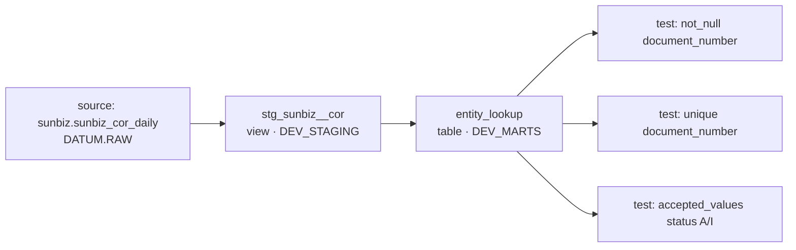

# dbt Reference — Datum

Running reference for dbt on Datum. Appended to as we go.
**Engine: dbt Fusion (dbt 2.0.8).** Project lives in `pipeline/`.
The deeper basics are in credit-stream's `DBT_REFERENCE.md`; this file covers
what Datum uses and what was different.

---

## What dbt Does (one paragraph to say out loud)

dbt takes SQL `SELECT` files, fills in their templates, works out the order they
depend on each other, and runs them against Snowflake — wrapping each one in
`CREATE VIEW` or `CREATE TABLE` for me. Then it runs tests that look for bad rows.
It does not move data in; that's `PUT` and `COPY`. dbt is the **T** in ELT
(extract, load, transform).

---

## Datum's DAG



**DAG** (directed acyclic graph) — the dependency map. "Directed" = arrows go one
way; "acyclic" = no loops. dbt builds it from every `source()` and `ref()` call.

---

## Project Files

```
pipeline/
├── dbt_project.yml                  project settings + folder-level configs
└── models/
    ├── staging/
    │   ├── _sunbiz__sources.yml     declares the raw table dbt didn't build
    │   └── stg_sunbiz__cor.sql      cuts lines into columns (view)
    └── marts/
        ├── entity_lookup.sql        one row per company + name_key (table)
        └── _marts.yml               tests on the mart
```

Credentials: `~/.dbt/profiles.yml`, profile `datum` (key-pair, SYSADMIN, DATUM_WH,
database DATUM, schema DEV, 4 threads). **Outside the repo. Never paste or commit it.**

---

## dbt_project.yml — Folder Configs

```yaml
models:
  datum:
    staging:
      +schema: staging          # → DEV_STAGING
      +materialized: view
    marts:
      +schema: marts            # → DEV_MARTS
      +materialized: table
```

- `+` = applies to everything in that folder
- **Custom schema naming:** dbt combines the target schema (`DEV`) with the custom one
  → `DEV_STAGING`. That's how DEV and a future PROD never collide.

**View vs table:**
| | View | Table |
|---|---|---|
| Stores | The query | The results |
| Cost to build | ~nothing | Runs the query |
| Cost to read | Runs the query every time | Fast |
| Datum | Staging (rarely read directly) | Marts (looked up constantly) |

---

## source() vs ref()

```sql
from {{ source('sunbiz', 'sunbiz_cor_daily') }}   -- a table dbt did NOT build
from {{ ref('stg_sunbiz__cor') }}                 -- a model dbt DID build
```
Both compile to a full table name and add an arrow to the DAG. Never hardcode
`datum.raw...` in a model.

---

## Model Pattern: Staging (parse fixed-width)

```sql
with source as (
    select line, source_file, loaded_at
    from {{ source('sunbiz', 'sunbiz_cor_daily') }}
),
parsed as (
    select
        trim(substr(line, 1, 12))                     as document_number,
        trim(substr(line, 13, 192))                   as entity_name,
        substr(line, 205, 1)                          as status_code,
        try_to_date(substr(line, 473, 8), 'MMDDYYYY') as file_date,
        nullif(trim(substr(line, 481, 14)), '')       as fei_number,
        length(line) >= 1436                          as is_well_formed,
        source_file, loaded_at
    from source
    where trim(line) <> ''
)
select * from parsed
```
CTE flow: **source** (import) → **parsed** (transform) → final `select`.

## Model Pattern: Mart (dedupe + normalize)

```sql
select
    document_number, entity_name, status_code, filing_type, principal_city,
    trim(regexp_replace(upper(entity_name), '[^A-Z0-9]+', ' ')) as name_key,
    source_file, loaded_at
from {{ ref('stg_sunbiz__cor') }}
where is_well_formed
qualify row_number() over (partition by document_number order by loaded_at desc) = 1
```

---

## Tests (dbt 2.0 syntax)

```yaml
version: 2
models:
  - name: entity_lookup
    columns:
      - name: document_number
        data_tests:
          - not_null
          - unique
      - name: status_code
        data_tests:
          - accepted_values:
              arguments:            # dbt 2.0 REQUIRES this nesting
                values: ['A', 'I']
```

A test is a query for bad rows: zero rows = pass.

---

## Commands

Run from the **VS Code terminal**, inside `~/datum/pipeline`:

| Command | Does |
|---|---|
| `dbt debug` | Checks the profile, the connection, and the project files |
| `dbt parse` | Reads every file and builds the DAG without touching Snowflake |
| `dbt compile` | Writes the final SQL (templates filled in) to `target/compiled/` |
| `dbt run` | Builds models only |
| `dbt test` | Runs tests only |
| `dbt build` | Builds and tests in DAG order; skips anything downstream of a failure |
| `dbt build -s entity_lookup` | Just that model (+ its tests) |
| `dbt build -s +entity_lookup` | That model and everything upstream of it |

Datum result (2026-10-21): `dbt build` → **5/5 passed** (2 models + 3 tests).

---

## Errors Hit and What They Taught

**`MacroSyntaxInvalid` at stg_sunbiz__cor.sql:35**
Cause: double curly braces inside a SQL `--` comment. **dbt renders Jinja before
SQL runs, and SQL comments mean nothing to Jinja.** Fix: describe the braces in words.

**`DbtYamlValidationError` on accepted_values**
Cause: `values:` directly under the test name (old style). dbt 2.0 requires test
settings under `arguments:`. The "unused config path" warning that appeared alongside
it was a side effect and vanished with the fix.

---

## Naming Conventions Used

- `stg_<source>__<table>` — staging models (`stg_sunbiz__cor`)
- `_<source>__sources.yml` — source declarations (underscore sorts it first)
- `_<folder>.yml` — tests and docs for that folder's models
- Marts named for what they serve (`entity_lookup`)

---

## Not Yet Used (add detail when we get there)

- Incremental models (when daily loads append to 13M rows)
- Seeds (the 50-name test set could be one)
- `dbt docs generate` / published docs site
- A `prod` target
- Source freshness (`loaded_at_field`) — alert if the daily load stops
