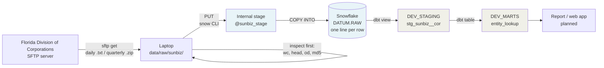
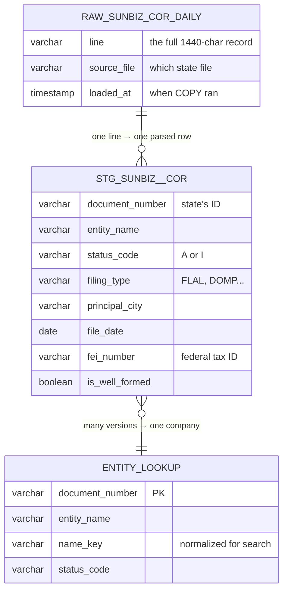

# Datum

**Risk and verification for small trade contractors.** Before a plumber, electrician
or roofer takes a job from a commercial client, Datum answers two questions from
the public record: *Is this a real, active company?* and *What's on the record
against it?* Every line of a report links to the official record it came from.

**Status:** pre-launch. First slice proven end to end on one daily state file;
loading the full Florida corporate register (12.99 million records).

**Scope (v1):** Florida, commercial clients only. Businesses only — no consumer
data, never an owner's personal credit (keeps Datum outside the FCRA, the Fair
Credit Reporting Act).

---

## Architecture



**Read it left to right:** the state publishes files → I download and inspect them
on the laptop → `PUT` uploads them to a Snowflake stage (a holding area for files)
→ `COPY INTO` loads each line as one row, untouched → dbt cuts each line into
columns (staging) → dbt keeps one clean row per company (mart) → the app looks
companies up.

**Planned layers (not built):** a model call for close name matches, and an agent
for long-tail lookups behind human review. Workflow first; the agent comes last.

---

## Data Model



**Grain** (what one row means):
- `raw.sunbiz_cor_daily` — one line of one state file
- `stg_sunbiz__cor` — the same, cut into columns, with a well-formed flag
- `entity_lookup` — **one row per company** (`document_number`), newest version

---

## Tool Choices & Tradeoffs

**Bulk files over scraping.** The state publishes the entire register as bulk files
for exactly this kind of use. Scraping the search website would be slower, fragile,
and closer to terms-of-use limits on automated access.

**Snowflake.** Separates storage from compute, so the data costs almost nothing
to keep and I pay only while a query runs. Guarded by an X-Small warehouse, 60-second
auto-suspend, and a resource monitor that suspends at 10 credits a month. Same tool
as credit-stream, so skills compound.

**Raw = one VARCHAR column per line.** The state file is fixed-width (each field
lives at fixed character positions, no delimiters). Loading the whole line untouched
means raw is an exact record of what the state sent; all parsing happens in dbt,
where it's version-controlled and testable. A parsing mistake is fixed by editing a
model, not by reloading 18.7 GB.

**dbt (Fusion engine).** SQL in files, built in dependency order, with tests.
Staging = views (cheap, always current); marts = tables (fast lookups).

**Internal stage, not S3.** Credit-stream uses S3 + a storage integration. Datum
doesn't need S3: the files come from SFTP to the laptop, and `PUT` uploads them
straight to Snowflake. One fewer system to secure and pay for. Revisit if loads
get automated on a server.

**One stage per file type.** The simplest thing that keeps daily and quarterly
files from mixing in one `COPY`.

**Key-pair authentication** for dbt and the `snow` CLI. No passwords in any file;
the private key lives in `~/.snowflake/`, outside the repo.

---

## Data Quality

Inspect before loading, then encode what I learned as tests.

| Check | Where | What it caught / guards |
|---|---|---|
| Line count vs the state's figure | laptop (`wc -l`) | Truncated downloads |
| Byte-level look at a record | laptop (`od -c`) | Found 4 NUL padding bytes per record (1440 = 1436 + 4) |
| Line length per file type | laptop (size ÷ lines) | Quarterly = CRLF endings (1442 bytes), daily = LF (1441) |
| Checksum two suspicious files | laptop (`md5`) | Disproved a suspected duplicate |
| `is_well_formed` flag | dbt staging | Lines split by stray line breaks — **flagged, not dropped** |
| `not_null`, `unique` on document_number | dbt test | One row per company in the mart |
| `accepted_values` A/I on status | dbt test | Field positions shifting (a shifted parse puts junk at position 205) |
| Known-answer lookup | Snowflake | DINATALE VENTURES LLC (L26000514010) found from the state's file |

---

## Testing

- **dbt tests** run on every `dbt build` (3 so far, all passing)
- **Known-answer test:** a company I looked up by hand on sunbiz.org must come back
  from the mart with the same ID and status
- **Planned:** a 50-name hand-checked test set. Name matching must hit **90%** before
  anything shows to a contractor as fact

---

## Running It

```bash
# 1. Snowflake objects. Run the scripts in snowflake/ in numerical order
#    (VS Code + Snowflake extension, or: snow sql -c datum -f snowflake/01_cost_guardrails.sql)

# 2. Download a state file (see docs/access/sunbiz.md for the server and paths)
sftp Public@sftp.floridados.gov

# 3. Upload and load
snow sql -c datum -q "PUT file://$PWD/data/raw/sunbiz/daily/20261009c.txt @datum.raw.sunbiz_stage"
#    then run snowflake/03_load_sunbiz_cor_daily.sql

# 4. Build and test the models
cd pipeline && dbt build

# 5. Check the known answer
#    run snowflake/05_validate_entity_lookup.sql
```

Credentials: `~/.snowflake/connections.toml` (snow CLI) and `~/.dbt/profiles.yml`
(dbt), both pointing at a private key in `~/.snowflake/`. None of these are in the repo.

---

## Repository Layout

```
datum/
├── README.md                 ← this file: what Datum is and how it works
├── PROGRESS.md               ← build log, day by day
├── CONCEPTS.md               ← glossary of everything learned
├── INTERVIEW_ANSWERS.md      ← defensible answers, rehearsed out loud
├── SNOWFLAKE_REFERENCE.md    ← Snowflake commands and gotchas
├── DBT_REFERENCE.md          ← dbt commands and patterns
├── UNIX_COMMANDS.md          ← terminal commands used
├── snowflake/                ← Snowflake SQL, run in number order
│   ├── 01_cost_guardrails.sql        resource monitor + warehouse
│   ├── 02_raw_layer.sql              database, schema, file format, stage, raw table
│   ├── 03_load_sunbiz_cor_daily.sql  COPY a daily file into raw + checks
│   ├── 04_sunbiz_cor_quarterly_stage.sql  stage for the full-register snapshot
│   └── 05_validate_entity_lookup.sql known-answer check on the mart
├── pipeline/                 ← the dbt project
│   ├── dbt_project.yml
│   └── models/
│       ├── staging/  _sunbiz__sources.yml, stg_sunbiz__cor.sql
│       └── marts/    entity_lookup.sql, _marts.yml
├── evals/                    ← the 50-name test set will live here (empty for now)
├── src/datum/                ← Python app code (placeholder)
├── tests/fixtures/           ← small sample files for tests (placeholder)
├── docs/                     ← business + planning docs (synced to the Claude Project)
│   ├── access/sunbiz.md      ← how to reach the state's files + record layout
│   └── runbook_first_slice.md
└── data/                     ← downloaded state files. GITIGNORED: never committed
```

---

## Roadmap

1. **Full Florida register** — load the 12.99M-record quarterly snapshot (in progress)
2. **50-name test set** + name matching at 90%
3. **More Sunbiz files:** fictitious names (DBAs), federal tax liens
4. **DBPR** (Department of Business and Professional Regulation) contractor licenses
5. **One county's liens**
6. **Report + mobile-friendly web app** (Postgres for the app)
7. **v1.1:** courts (including federal bankruptcy via the CourtListener REST API)
   and UCC (Uniform Commercial Code) filings
8. **Automated daily loads** in Python (SFTP + Snowflake connector)

---

## Known Limitations

- **Pre-launch.** No paying users yet; outreach runs in parallel with the build.
- **Loads are manual** (download, PUT, COPY). Fine for a quarterly snapshot plus
  daily updates; automation is on the roadmap.
- **`file_date` meaning unverified.** Some values are in the future, so it may be an
  effective date rather than a filing date.
- **No official-record links yet.** Sunbiz detail pages use an ID that isn't in the
  bulk file; linking each report line is an open problem.
- **`name_key` is basic** (uppercase, punctuation → spaces). Doesn't yet strip
  LLC/INC or expand abbreviations.
- **DEV only.** No PROD environment until the app reads data.
- **Not legal advice, not credit advice.** Outputs are sourced facts. A lawyer
  reviews before launch.
