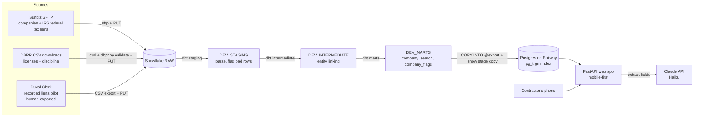

# Datum MVP Sprint: Oct 30 – Nov 8, 2026

**Owner:** Andres Camacho · **Written:** Oct 30, 2026 · **Status:** proposed, waiting on your approval of §2
**Lives at:** `~/datum/docs/mvp_plan_nov8.md` (source of truth), copied to the Datum project. Timeline mirrored on Mission Control.

> **The goal in one sentence:** by **Sunday, Nov 8**, a private, mobile-friendly web app where a contractor types what they know about a commercial client and gets a one-page report: who the company legally is, plus **risk flags from four public sources** (Sunbiz company record, IRS federal tax liens, DBPR contractor licenses and discipline, Duval recorded liens as a pilot), with every line linked to its official record. Interviews start **Monday, Nov 10**, in Jacksonville.

---

## Re-plan, Mon Nov 2: 3–5 hours a day, launch-ready Fri Nov 13

Oct 30 – Nov 1 were off, and 3–5 focused hours a day is the realistic pace. **Same scope, same order, dates moved.** Interviews still start Mon Nov 10. Those first conversations are about the contractor's problem and don't need the demo; the demo joins once it's ready.

| Date | Hours | Plan day | Ships |
|---|---|---|---|
| Mon Nov 2 | 1 | — | Records request text ready + federal lien files pulled and inspected (the Clerk takes requests by phone, so the call is Tue 8 AM) |
| Tue Nov 3 | 3–5 | Day 1 | Claude Code harness + DBPR and Duval recon |
| Wed Nov 4 | 3–5 | Day 2 | #1 IRS federal tax liens linked |
| Thu Nov 5 | 3–5 | Day 3 | #3 DBPR licenses + 50-case eval |
| Fri Nov 6 | 3–5 | Day 5 | Flags mart + Postgres serving |
| Sat Nov 7 | 3–5 | Day 6 | Web app |
| Sun Nov 8 | 3–5 | Day 7 | #4 Report v1 with flags |
| Mon Nov 9 | 2–3 | Day 4 | #2 Duval pilot for the demo companies (hand-collected) |
| Tue Nov 10 – Thu Nov 12 | evenings | Days 8–9 | Deploy + CI; break-it test; 5 hand-verified demo reports (around interviews) |
| **Fri Nov 13** | | Day 10 | **v0.1.0 launch-ready** |

**Cut order is unchanged (§9).** Cut first if the pace slips: the overnight loop, the Claude PR review, DBPR discipline. The Duval pilot moved to the end because its records request needs time to come back; the hand-collected pilot doesn't depend on it.

---

## Today, Fri Oct 30: the first three things to do (superseded by the re-plan above)

1. **Here (Datum Build chat):** reply "approve" to the six decisions in §2, or tell me what to change.
2. **VS Code terminal:** move your Anthropic key out of `~/.zshrc` and into `~/datum/.env` (Day 1, step 1 explains why: it can silently switch Claude Code to per-token billing).
3. **Claude Code:** start Day 1, step 2 (CLAUDE.md commands) in plan mode.

---

## 0. How to use this plan

- **One section per day.** Each day has: the goal, why it matters, numbered steps tagged with *where they run*, the Claude Code technique you practice, what you learn, a checkable **done-when**, and a cost line.
- **Where things run:**
  - **[VS Code terminal]** is your shell.
  - **[Claude Code]** is `claude`, running inside that terminal.
  - **[Browser]**, **[Phone]** and **[Here]** (this Datum Build chat) are what they say.
  - Snowflake SQL runs from VS Code with `snow sql -c datum -f snowflake/NN_*.sql`, never Snowsight worksheets.
- **Division of labor:**
  - **Claude Code** writes and runs the code against checks.
  - **This chat** owns architecture, tier-1 reviews, teaching, decisions, dashboards and close-outs.
  - When you want a review, paste Claude Code's summary (or the diff) here.
- **If a day slips,** the next day starts by finishing it. Don't skip ahead. If you're a full day behind by Wed Nov 4, apply the cut order in §9.
- **Assumes about 5 focused hours a day** 🔴 (assumed). With less time, the cut order decides what moves.

---

## 1. Definition of done: the MVP spec

The spec comes first, so Claude Code always has a target ("spec-driven development"). Each line is a test we can run or check by hand.

| # | Acceptance test | How we check it |
|---|---|---|
| A1 | On a phone, typing `ferguson ac boynton beach` returns a shortlist in under 3 seconds, with FERGUSON AIR CONDITIONING & REFRIGERATION, INC. at #1 | Known-answer check on the deployed URL |
| A2 | A vague note (`the pool guy off race track rd`) asks for a name, street or owner and **never** shows a company | Eval case + manual check |
| A3 | A company with an IRS federal tax lien shows a lien flag: filing date, filing number, status (active / released), source link, fetched date | Known lien company from Day 2 |
| A4 | A company with a linked DBPR license shows license status, and any discipline record, with links | Known licensed company from Day 3 |
| A5 | The Duval section is labeled **pilot**. Each lien shows instrument number, recording date and the "may have lapsed" note | Demo company from Day 4 |
| A6 | **Every** fact has a source link and a fetched date. Building a fact without both raises an error | pytest on the `Fact` model (CLAUDE.md rule 3) + dbt `not_null` tests |
| A7 | Flags attach only to **CONFIRMED** links. **AMBIGUOUS** ones show as "possible match: verify" and aren't counted | Linkage eval + unit test |
| A8 | The report lists sources checked and sources **not** checked. When nothing turns up it says "No flags found in the sources checked" (never "clean") | Template test |
| A9 | Private: an access code is required, and search engines are told not to index it | Manual check + `noindex` meta tag |
| A10 | Lookup eval on 50 cases is at least as good as v1 (recall@5 ≥ 90%). Linkage eval: **0 wrong** among CONFIRMED on ≥ 30 hand-checked links | `python -m evals.run` |
| A11 | Usable at iPhone width (390 px): no sideways scrolling, buttons easy to tap | Chrome device toolbar + your phone |
| A12 | Spend is capped everywhere: Snowflake resource monitor, Railway usage limit, Anthropic Console spend limit | Screenshots in `docs/costs.md` |

**Not in the MVP:**
- sign-up or accounts
- payments
- the watchlist
- court cases, UCC (Uniform Commercial Code) filings, other counties
- automated Duval retrieval
- a numeric score
- bureau data

---

## 2. Decisions to approve (they change the roadmap)

| # | Decision | Why | Revisit |
|---|---|---|---|
| d15 | **MVP by Nov 8:** web app + Sunbiz + federal tax liens + DBPR licenses/discipline + Duval lien pilot + risk flags with citations. Interviews start Nov 10 | A Sunbiz-only report isn't worth a contractor's time; collating several sources is the product. You're in NYC until Nov 9, so build time is now | Nov 8 close-out |
| d16 | **Risk flags from public records, not a numeric score or bureau data, in v1** | (1) Business FICO (FICO SBSS) blends the owner's personal credit, which is FCRA (Fair Credit Reporting Act) territory. (2) Bureau reports cost $40–200+ each ✅ (research log). (3) A score needs outcome data (who actually didn't pay), and we have none. (4) It breaks your first commitment: "No black-box score" | After 20 interviews, or once outcome data exists |
| d17 | **Duval liens: a human-collected pilot plus a Chapter 119 (Florida public records law) request for the full index. No automated retriever until counsel reviews the click-through gate** | The recon found no bulk file and no API. Automating the disclaimer gate is legally unresolved (`docs/access/duval-official-records.md`). The approved scope already says "one county's liens, piloted with human review" | When the Clerk answers or counsel weighs in |
| d21 | **Replaces d17 (approved Nov 5). Duval liens come from the Clerk's free bulk recording index over secure FTP. Individuals' records stay in raw; staging keeps only parties that match a company** | The Clerk offered the full index at no cost (email, Nov 4): the official channel, complete, and no click-through gate | If their terms restrict commercial use, or access isn't live by Nov 9 (then hand-collect for the demo) |
| d18 | **Serving layer: Postgres with `pg_trgm` (trigram fuzzy search) on Railway answers lookups. Snowflake only runs the builds** | Waking a suspended X-Small warehouse costs about $0.033 per lookup vs about $0.00035 for the Haiku call ✅ (roadmap chat's math), and adds seconds. Postgres also keeps the app alive after the Snowflake trial ends around Nov 15 | At 100 lookups/day, or if the database outgrows the Railway plan |
| d19 | **Linking rule: flags attach only on CONFIRMED** (same name once legal suffixes are removed, and the same ZIP code, or the only company with that name). AMBIGUOUS shows as "possible match: verify" | Accusing the wrong company of a lien is the most expensive error Datum can make (asymmetric error costs, Day 6 lesson) | If CONFIRMED coverage is under 50% of lien records |
| d20 | **Web stack: FastAPI + server-rendered Jinja templates + Pico CSS. No JavaScript framework** | Simplest correct option, mobile-first, all Python (the language you're building skills in) | When the watchlist needs live interactivity |

---

## 3. Architecture



How to read it:
- **Left half (warehouse):** heavy, batch, cheap per row. It loads and transforms millions of records once a night (or once a quarter), with dbt tests guarding every layer.
- **Right half (serving):** a lookup is a quick query against data that's ready. This is the **OLAP vs OLTP** split:
  - OLAP (online analytical processing) means big scans: Snowflake.
  - OLTP (online transaction processing) means small, fast lookups: Postgres.
  - Interviewers ask about this split constantly.
- **New dbt layer: intermediate.** Staging describes each source as it is. Intermediate is where sources meet: matching a lien's debtor name to a company. Marts shape the result for the app.
- **Reverse ETL** (extract, transform, load): copying finished marts out of the warehouse into the app's database. You'll do it by hand with the CLI first (Day 5), so you understand each step before automating it.

---

## 4. What the report flags (MVP)

| Flag | Source | Rule | Example wording | Caveat shown |
|---|---|---|---|---|
| Inactive with the state | Sunbiz company record (loaded) | `status_code = 'I'` | "Inactive with the Florida Division of Corporations" | Data as of the snapshot date; changes since then aren't covered until the events file is loaded |
| New company | Sunbiz (loaded) | Date on record within 12 months | "On record since 2026-03-14" | "May be an effective date" |
| IRS federal tax lien | Sunbiz federal lien files (Day 2) | CONFIRMED link to a lien filing | "IRS federal tax lien filed 2025-03-14, filing #…, status: active" | Release status from the events file |
| Recorded claim of lien / judgment (pilot) | Duval Official Records (Day 4) | CONFIRMED link, company named as property owner or judgment debtor | "Claim of lien recorded 2026-05-02 by ACME ROOFING LLC, instrument #…" | "Florida construction liens generally expire 1 year after recording unless a lawsuit to enforce them is filed 🟡 (confirm with counsel). Check for a release." |
| License inactive / discipline | DBPR (Day 3) | Linked license with an inactive status, or any discipline record | "Certified general contractor license CGC…: inactive" / "Discipline case closed 2025-01-10" | "The DBPR file leaves out delinquent and involuntarily inactive licenses, so 'not found' doesn't mean 'never licensed'" ✅ (DBPR page) |

**The summary line** counts only CONFIRMED flags: "**2 flags found** in 4 sources checked." Each flag card shows the fact, its date, a source link and the date Datum fetched the data. **Facts, never conclusions** (CLAUDE.md rule 2): "IRS federal tax lien filed," never "doesn't pay taxes."

**Linking rule (deterministic SQL, no model call):**
- `match_key` = `name_key` with the trailing legal suffix removed (LLC, INC, CORP…).
- **CONFIRMED:** same `match_key` **and** same 5-digit ZIP code, or the only active company statewide with that `match_key`.
- **AMBIGUOUS:** same `match_key`, several companies, no ZIP code agreement.
- **NO_MATCH:** otherwise.

Fuzzy linking (typos in lien records) waits for a measured need. Precision over coverage.

---

## 5. How we work with Claude Code (the operating system)

This puts the roadmap chat's [Agentic Engineering Playbook](https://claude.ai/artifact/5kPPEfSV7CvHLZh8STBv2K) and [Bootcamp](https://claude.ai/artifact/Ybmk2dEv2nDi3cZ5i44RbQ) to work on real Datum features. Rungs 1 through 6 of the skill ladder all get used this sprint.

**Review by risk, not by line.** Tag every change before Claude writes it:

| Tier | For | You do | This sprint |
|---|---|---|---|
| 1. Read and explain back | New concepts, anything where a bug is a wrong fact, a leak or a legal issue | Approve the plan, read every line, explain it out loud, answer 3 quiz questions | First parser of each new file type, the linking rule, `Fact` model, report wording, hooks, export to Postgres, Railway env vars |
| 2. Plan + skim the diff | A pattern you've done once | Approve the plan, check that the checks pass, skim for surprises | Second and later staging models, numbered Snowflake scripts, templates |
| 3. Trust the checks | Boilerplate, renames, doc syncs | Read the commit message | Study-guide updates, formatting, README |

**The loop for every feature:**
1. **Spec.** Name the acceptance test it serves (§1).
2. **Plan mode** (Shift+Tab). You approve the files, steps and the check.
3. **Build with a check.** Claude runs `pytest`, `dbt build --select …` or `evals.run`, and fixes its own failures.
4. **Review by tier.** The reviewer subagent reviews tier 1 diffs first.
5. **Commit small on a branch, then a PR.**
6. **Capture** with the `/close-out` skill: study guide, PROGRESS, and one CLAUDE.md line if you corrected Claude twice on the same thing.

**The three loops you'll run:**
- **Inner loop (every task):** act, run the check, fix, repeat until green. A loop only works when a check exists.
- **Eval loop (every search or linking change):** change one thing, run `python -m evals.run`, compare with `evals/history.csv`, then keep or reject it (the Day 6 v2 decision, now automated).
- **Unattended loop (Day 7 night):** headless `claude -p` on its own branch, with the eval as the goal, a turn cap and a dollar cap, ending in a PR you judge by its eval diff.

**Evals (two sets, one command):**

| Eval | Set | Metrics | Gate |
|---|---|---|---|
| Lookup | `pipeline/seeds/test_set.csv`, grown to 50 on Day 3 | top-1, recall@5, wrong_match, ask rate, $ per run | recall@5 ≥ 90%, wrong_match ≈ 0 |
| Linkage | `evals/linkage_set.csv`, ≥ 30 hand-checked lien/license links | wrong among CONFIRMED, CONFIRMED coverage | **0 wrong** |

**Charts:**
- the eval history (Mission Control's "Search versions scored" chart, plus `evals/history.csv`)
- the dbt lineage graph (`dbt docs generate`: a DAG, or directed acyclic graph, of every model; a great interview visual)
- the architecture diagram above, in the README

**Harness built on Day 1:**
- `CLAUDE.md` with the commands that prove work, under 60 lines.
- `CLAUDE.local.md`, git-ignored, holding your teaching preferences.
- Three skills: `teach-mode`, `new-snowflake-script`, `close-out`.
- A read-only `reviewer` subagent.
- Two hooks:
  - one blocks secrets;
  - one won't let Claude finish while cheap checks fail.
- A git pre-push hook that refuses pushes to `main`.

**Guardrails** (from the Bootcamp):
- Agents work on branches, never `main`.
- Every unattended run has a done condition, a cap, and a PR you approve.
- Secrets stay unreadable to Claude.
- Nothing reaches a contractor until you've verified it by hand. That rule holds until the eval clears 90%.
- We review together before anything is customer-facing.

**Cost hygiene:**
- Run `/clear` between tasks; the whole conversation is re-sent every turn.
- Run `/usage` at the end of the day.
- Keep effort at medium for routine models, and raise it for linking logic.
- Before every headless run, check `/status` shows the billing you expect. If `ANTHROPIC_API_KEY` is set in your shell, Claude Code can bill per token instead of your plan 🟡.

---

## 6. Skills you'll practice

| Area | Where in the sprint | What you'll be able to say in an interview |
|---|---|---|
| **Snowflake** | Day 2 (four new stages, same fixed-width format), Day 3 (CSV file format with headers and quotes vs fixed-width), Day 5 (**unloading** with `COPY INTO @stage`), cost per load | "I load fixed-width and CSV sources through internal stages with one stage per file type, and unload marts to a serving database." |
| **dbt** | Days 2–5: sources, staging, the new **intermediate** layer, marts, `relationships` and `accepted_values` tests, `not_null` on provenance, seeds, **exposures** (the web app as a declared consumer), `dbt docs` lineage | "Facts can't reach the app without a source URL and fetch time; dbt tests enforce it." |
| **SQL** | Linking joins, window functions for latest lien status, anti-joins for coverage, Postgres trigram search, `EXPLAIN ANALYZE`, GIN indexes | "I read query plans and chose a GIN trigram index for fuzzy name search." |
| **Python** | Day 3 `DbprFile` class (download, validate, save), Day 5 `SearchService` with two backends behind a `Protocol` (an interface), Day 6 Pydantic models (`Fact` requires provenance) and dependency injection for offline tests, FastAPI routes, pytest fixtures, `pyproject.toml` | "Validation runs before data lands; the search backend is swappable behind an interface, so tests run offline." |
| **CLI** | `sftp`, `curl`, `unzip -l`, `wc`, `psql` and `\copy`, `snow stage copy`, `pg_dump` / `pg_restore`, `git worktree`, `gh pr create`, git hooks, `claude -p` | Comfortable at the terminal, from download to deploy |
| **Engineering design life cycle** | Spec (§1) → decisions as ADRs (architecture decision records) in `docs/adr/` → build with checks → evals → deploy → monitor costs → iterate | "Every big choice has a written record: what we chose, why, what we gave up, when to revisit." |
| **Claude Code** | Harness, skills, subagent, hooks, plan mode, worktrees, headless loop, CI, PR review | "I build with agents inside checks: plans I approve, hooks that enforce rules, evals that decide." |

---

## 7. Day by day

### Day 1 · Fri Oct 30 · Harness + recon

**Goal:** Claude Code set up the way the best teams use it, and every new source inspected before we build on it.
**Why:** Checks and hooks first means every later day goes faster, because Claude fixes its own failures. Recon first means no building on guesses, the same "inspect before loading" habit that's in your interview story.

1. **[VS Code terminal] Secrets hygiene (10 min).**
   - Delete the `export ANTHROPIC_API_KEY=…` line from `~/.zshrc`.
   - Put it in `~/datum/.env` as `ANTHROPIC_API_KEY=...`.
   - Add `.env` to `.gitignore`. It isn't there today.
   - The app and scripts will load it with `python-dotenv`.
   - Why: a key exported in every shell can quietly switch Claude Code to per-token billing, and Claude can read it. The hook in step 6 makes `.env` unreadable to Claude.
2. **[Claude Code, plan mode, tier 1] CLAUDE.md commands.** Paste:
   > Read CLAUDE.md, docs/PROJECT_CONTEXT.md and README.md. In plan mode, propose a "Commands that prove work" section for CLAUDE.md: the exact commands to run dbt from pipeline/, run a numbered Snowflake script with `snow sql -c datum -f`, run pytest and the eval inside .venv, and one line on where secrets live (never read them). Keep CLAUDE.md under 60 lines. Put my teaching preferences (comment every line; after each block explain syntax, concept and design decision; spell out acronyms) in CLAUDE.local.md and add it to .gitignore.

   Check: `/context` shows both files loaded.
3. **[Claude Code, tier 2] Three skills** in `.claude/skills/<name>/SKILL.md`:
   - **`teach-mode`:** the teaching rules from `CLAUDE.local.md`, plus a 3-question quiz after tier-1 changes.
   - **`new-snowflake-script`:** picks the next number, writes a header saying what it does and when to run it, uses the line-comment style of 01–12, and ends with `-- Syntax / -- Concept / -- Design decision`.
   - **`close-out`:** updates PROGRESS.md (new day entry), CONCEPTS.md, INTERVIEW_ANSWERS.md and the reference files from today's commits, then drafts the close-out in the Decisions format.

   Done when you can type `/close-out` and it runs.
4. **[Claude Code, tier 1] Reviewer subagent:** `.claude/agents/reviewer.md`.
   - Tools: `Read, Grep, Glob` only, so it can't edit.
   - It checks diffs against CLAUDE.md rules 1–5, FCRA drift (no personal credit, no person-centric indexes), secrets, terms of use for automated access, Snowflake and API cost, and missing tests.
   - Output: findings with file:line and severity.
5. **[VS Code terminal] Protect `main` for free:**
   - GitHub branch protection on a *private* repo needs a paid plan 🟡.
   - So add a git **pre-push hook**, `.git/hooks/pre-push`, that refuses pushes to `main`. Claude Code can write it, and you read it at tier 1.
   - Work on feature branches (`git switch -c feat/federal-liens`) and merge with `gh pr create` / `gh pr merge`.
6. **[Claude Code, tier 1] Hooks in `.claude/settings.json`:**
   - **(a) `PreToolUse` blocks secrets.** It stops any read, edit or shell command touching `.env`, `~/.dbt/profiles.yml`, `~/.snowflake/` or `*.p8`.
   - **(b) `Stop` runs the cheap checks.** These are `ruff check`, `pytest -q` and `dbt parse`, with no warehouse. It blocks finishing while they fail.
   - Why not `dbt build` in the hook? Hooks run every time, so they must be cheap. A Stop hook that wakes Snowflake would bill about $0.03 per stop.
   - Prove both work:
     - ask Claude to `cat .env` (it should be blocked);
     - break a test and watch Claude fix it before it's allowed to stop.
7. **[Browser] Federal lien layouts (20 min).**
   - Open the "Federal Tax Lien File Definitions" page from the Sunbiz data-downloads pages. Its site blocks automated fetching, so you read it.
   - Paste the text into Claude Code: "turn this into `docs/access/sunbiz_flr.md` with a layout table per file."
   - Answer three questions:
     - Does the debtor file carry a Florida document number or FEI (federal employer identification number)?
     - Is a dollar amount included?
     - How do releases appear in the events file?
8. **[VS Code terminal] Pull and inspect the lien files (30 min).**
   - `sftp`: from `doc/quarterly/flr`, get `flrf.zip`, `flrd.zip`, `flre.zip`, `flrs.zip`. From `doc/flr/filings` and `doc/flr/debtors`, get one recent daily file each.
   - Inspect: `unzip -l`, `wc -l`, `head -c 400`, size ÷ lines.
   - Write the findings into `sunbiz_flr.md`, "Verified by manual pull (Oct 30)."
9. **[VS Code terminal] DBPR files (15 min).**
   - `curl -O` the licensee file `https://www2.myfloridalicense.com/sto/file_download/extracts//CONSTRUCTIONLICENSE_1.csv` (the double slash is in their URL).
   - `curl -O` the discipline files `contractor_disc_lic_2526.csv` and `contractor_disc_lic_2425.csv` from `https://www2.myfloridalicense.com/pro/cilb/reports/`. Put them in `data/raw/dbpr/`.
   - Inspect: `head -3`, `wc -l`.
   - Read the [ReadMe/Disclaimer](https://www2.myfloridalicense.com/public-records-read-medisclaimer/) and quote it in `docs/access/dbpr.md` (CLAUDE.md rule 2).
10. **[Browser] Duval, as a member of the public (30 min).**
    - Accept the disclaimer yourself and run a Document Type search for claims of lien recorded in the last 30 days.
    - Answer four questions in `duval-official-records.md`, under "Verified by manual check (Oct 30)":
      - What are the document-type codes?
      - Which party role is the owner and which is the lienor?
      - Is there an **Export to CSV** button?
      - Can a record be found again by instrument number?

**Technique:** harness = skill-ladder rungs 1–4. Concept: deterministic rules (hooks, deny rules) vs judgment (CLAUDE.md, skills).
**You learn:** Claude Code configuration, git hooks, CSV vs fixed-width inspection, `curl`.
**Done when:**
- CLAUDE.md is under 60 lines and loaded.
- `.env` is blocked for Claude.
- The Stop hook caught a failing test.
- `/close-out` runs.
- The three recon notes answer their questions.

**Cost:** $0 Snowflake; plan usage only.

### Day 2 · Sat Oct 31 · IRS federal tax liens, end to end (#1)

**Goal:** Every federal tax lien filed with the Florida Department of State is in Snowflake, parsed, and linked to the company it names.
**Why:**
- It's the fastest win: same server, same fixed-width pattern you already know.
- An IRS lien is a direct "doesn't pay its bills" signal from a government creditor.
- Florida law sends federal liens (IRS tax liens and other federal liens) on the *personal property* of Florida-based corporations and partnerships, plus trusts and estates, to the Secretary of State, which runs Sunbiz ✅ ([Fla. Stat. § 713.901(3)(c)](https://m.flsenate.gov/Statutes/713.901)). Liens on real estate, and liens against individuals, go to the county clerk instead. Whether liens against LLCs land here too is open 🟡: count debtor names ending in LLC on Day 1.
- Each filing has a 12-digit document number, the debtor's name and address, an **optional FEIN** (federal employer identification number), and a status of active, lapsed or terminated. Filings expire 10 years and 30 days after the assessment date ✅ ([Sunbiz federal lien guide](https://dos.fl.gov/sunbiz/search/guides/federal-lien-registration)).

1. **[Claude Code, plan mode, tier 2]** `/new-snowflake-script` creates `snowflake/13_federal_liens_raw.sql`: four stages and four raw tables (one per file type, decision d9), reusing the `fixed_width` format. Check: it runs with `snow sql`, and `LIST` shows the files.
2. **[VS Code terminal]** `PUT` the quarterly files plus the daily ones, then `COPY`.
   - Validate per file: rows = size ÷ line length, the same check as Oct 22.
3. **[Claude Code, tier 1 for the first file, tier 2 after]** Staging models:
   - `stg_sunbiz__flr_filings`, `stg_sunbiz__flr_debtors`, `stg_sunbiz__flr_events`, using positions from `sunbiz_flr.md` and the `is_well_formed` flag.
   - Tests:
     - `not_null` + `unique` on the filing number;
     - `relationships` from debtors to filings (every debtor belongs to a real filing).
   - Check: `dbt build --select +stg_sunbiz__flr_filings+`.
4. **[Claude Code, tier 1] Intermediate layer** (add `+schema: intermediate` in `dbt_project.yml`):
   - `int_company_match_keys`: `match_key` and ZIP5 for every company.
   - `int_federal_liens`: each filing with its latest status from the events file (a window function).
   - `int_federal_lien_links`: debtor → `document_number` with CONFIRMED / AMBIGUOUS / NO_MATCH per §4.
   - **If the debtor file carries a document number, link on it directly.** That's a deterministic join, and better than names.
   - **If a debtor has an FEIN, link on it first:** an exact join to the FEI field in the corporate file (positions 481–494). Fall back to name + ZIP only when the FEIN is blank.
5. **[Browser, tier 1, 45 min] Linkage eval v0:**
   - Hand-check 20 links (10 CONFIRMED, 10 AMBIGUOUS) on Sunbiz.
   - Write them to `evals/linkage_set.csv` (`debtor_name, expected_document_number, link_status, verified_on, notes`).
   - **Gate: 0 wrong among CONFIRMED.**
6. **[Claude Code]** `/close-out`.

**Technique:** spec → plan → build with a check. First use of the intermediate layer.
**You learn:**
- one-to-many file relationships;
- `relationships` tests;
- precision vs coverage in entity linking;
- window functions for "latest status."

**Done when:** `dbt build` is green with the new models, the linkage eval shows 0 wrong among CONFIRMED, and the count of linked liens is recorded.
**Cost:** about 0.1–0.3 credits for loads and builds 🔴 (estimate), roughly $0.20–0.60 of trial credit.

### Day 3 · Sun Nov 1 · DBPR licenses and discipline (#3) + the 50-case eval

**Goal:** Construction licenses and discipline records linked to companies, and the lookup eval grown to 50 real-world cases.
**Why:**
- When the client is a general contractor or developer, an inactive license or a discipline case is a strong signal.
- The 50-case eval was due today, and lien and license names are real strings typed by *other people*. That's exactly the kind of messy input a test set needs.

1. **[Claude Code, tier 1: your first Python class]** `src/datum/ingest/dbpr.py`:
   - `class DbprFile` with `download()`, `validate()` (expected header, row count > 0, last line not truncated) and `save()`.
   - pytest against a 20-line fixture in `tests/fixtures/` (rule 4: fixtures, no network), plus a corrupted fixture that `validate()` must reject.
   - This answers your interview feedback: Python written as classes, with validation before data lands.
2. **[Claude Code, tier 2]** `snowflake/14_dbpr_raw.sql`:
   - a **CSV file format** with header, quotes and comma delimiter (compare it line by line with `fixed_width`);
   - a stage per file type;
   - `COPY`.
3. **[Claude Code, tier 2]** `stg_dbpr__licenses`, `stg_dbpr__discipline`, `int_license_links` (licensee business name → company, same rule), and tests.
4. **[Claude Code drafts, you verify: tier 1] Grow the lookup eval to 50:**
   - Claude drafts 40 inputs from federal lien debtor names and DBPR business names, written the way a contractor would type them.
   - You check each expected document number on Sunbiz.
   - Include at least 5 `NEEDS_MORE_INFO`, 5 inactive companies and 5 near-twins.
5. **[Claude Code, tier 2]** `evals/run.py`:
   - One command, `python -m evals.run`, prints top-1, recall@5, wrong_match, ask rate and $ per run.
   - It appends a row to `evals/history.csv`.
   - Record the **baseline on 50 cases**.

**Technique:** an agent drafts, a human verifies (the right split for eval data). Evals = rung 5.
**You learn:** Python classes, validation, pytest fixtures, CSV loading in Snowflake.
**Done when:** pytest and `dbt build` are green, `test_set.csv` has 50 hand-checked rows, and the eval prints its baseline.
**Cost:** about 0.1 credits. Haiku extraction for 50 cases ≈ $0.02 ✅ (roadmap chat).

### Day 4 · Mon Nov 2 · Duval lien pilot (#2) + records request

**Goal:** A human-reviewed pilot of Duval recorded liens and judgments, linked to companies, and the request for the full index sent.
**Why:** Recorded liens and money judgments are the strongest "do they pay" evidence. The full index needs either the Clerk's export or counsel, so the pilot proves the product while the request runs.

1. **[Email / phone, 9 AM]** Send the Chapter 119 request (Appendix A). Use the Clerk's public-records request route or call (904) 255-1828 (number from the recon). Log the date in `research_log.md`.
2. **[Browser]** Two options:
   - **If Export to CSV exists:** export claims of lien, releases/satisfactions and judgments recorded in the last 12 months, in whatever date chunks the site allows. Save to `data/raw/duval/`.
   - **If it doesn't:** hand-collect a pilot seed of 20 recent claims of lien, plus any records for the demo companies. Columns: instrument number, recording date, document type, parties with roles, amount, checked_on.
3. **[Claude Code, tier 2]** `snowflake/15_duval_pilot_raw.sql` (or a dbt seed if it's small), then `stg_duval__official_records` and `int_county_lien_links`. Only the owner or judgment-debtor party links, and only CONFIRMED links become flags.
4. **[Claude Code, tier 1]** `docs/adr/0003-duval-pilot.md`, your first architecture decision record. It covers why a manual pilot, the legal posture, and the citation format: instrument number + recording date + "search by instrument number at or.duvalclerk.com". Duval has no permalink.
5. **[Browser]** Hand-check 10 Duval links into `evals/linkage_set.csv`.

**You learn:** ADRs, legal constraints as design inputs, role-aware joins.
**Done when:** pilot data is loaded and linked with tests, the ADR is committed, and the request date is logged.
**Cost:** ~$0.

### Day 5 · Tue Nov 3 · Serving layer: Snowflake → Postgres + the flags mart

**Goal:** A Postgres copy of the search and flags data that answers a lookup in under a second.
**Why:** It's decision d18 in practice: fast, cheap lookups, and an app that survives the end of the Snowflake trial.

1. **[Claude Code, tier 1] Marts:**
   - `mart_company_flags`: one row per flag, with `document_number, flag_code, label, fact_text, fact_date, amount, source_name, source_url, record_id, fetched_at, link_status`.
   - Tests:
     - **`not_null` on `source_url` and `fetched_at`** (rule 3 enforced in the data);
     - `accepted_values` on `flag_code`.
   - `mart_company_search`: slim columns for search.
   - Declare the app as a dbt **exposure**.
2. **[VS Code terminal]**
   - `brew install postgresql@17`
   - `brew services start postgresql@17`
   - `createdb datum_dev`
   - `psql datum_dev -c "CREATE EXTENSION pg_trgm;"`
3. **[Claude Code, tier 1: unloading]** `snowflake/16_export_marts.sql`:
   - `COPY INTO @datum.dev_marts.export_stage/...` as gzip CSV;
   - then `snow stage copy` to `data/export/`;
   - then `psql \copy` into tables;
   - then `CREATE INDEX … USING gin (name_key gin_trgm_ops);`.
4. **[psql, tier 1]**
   - Run `EXPLAIN ANALYZE` on `WHERE name_key % $1 ORDER BY similarity(name_key, $1) DESC LIMIT 20` for the 50 eval inputs, and record p50 and p95 latency.
   - Record table + index sizes with `pg_size_pretty(pg_total_relation_size(...))`. **That number picks the host:** Railway if it's under about 4 GB, Supabase Pro (8 GB) otherwise 🟡.
5. **[Claude Code, tier 1]** `src/datum/search.py`:
   - `SearchService` with `SnowflakeBackend` and `PostgresBackend` behind one `Protocol`.
   - Postgres retrieves 20 candidates by trigram, then the v1 logic re-ranks them (Jaro-Winkler + evidence levels): **retrieve-then-rerank again.**
   - `python -m evals.run --backend postgres` must match or beat Snowflake.
6. **[Claude Code]** `docs/adr/0001-serving-layer.md` with the cost line.

**You learn:** reverse ETL, unloading, Postgres extensions, GIN indexes, query plans, interfaces in Python.
**Done when:** Postgres matches Snowflake on the eval, p95 < 1 s 🔴 (target), and sizes are recorded.
**Cost:** unload ≈ 0.05 credits; local Postgres $0.

### Day 6 · Wed Nov 4 · The web app, in two parallel sessions

**Goal:** The app runs on your laptop: search → shortlist → report, readable at phone width.

1. **[VS Code terminal] Two worktrees**, then one Claude Code session in each:
   - `git worktree add ../datum-app -b feat/web-app`
   - `git worktree add ../datum-models -b feat/report-models`
2. **Session A (tier 1 for the first route, then tier 2):** `src/datum/web/`, a FastAPI app.
   - Routes: `/`, `/search`, `/company/{document_number}`, `/healthz`.
   - Jinja2 templates with Pico CSS (mobile-first, no custom framework).
   - An access code via HTTP Basic, from env `APP_ACCESS_CODE`.
   - `<meta name="robots" content="noindex">`.
   - Tests with FastAPI's `TestClient` and a **fake search backend**: dependency injection means no network in tests.
3. **Session B (tier 1):**
   - `src/datum/models.py`: Pydantic `Fact` (raises without `source_url` and `fetched_at`), `Flag`, `Candidate`, `Report`.
   - `src/datum/report_builder.py`: `ReportBuilder.build(document_number)`.
   - Tests.
4. **[Claude Code]** The reviewer subagent checks both branches, then fixes, then `gh pr create` and you merge.

**Technique:** parallel sessions on separate pieces (2 sessions ≈ 2× plan usage, not a swarm) + writer/reviewer.
**You learn:** web routing, templates, Pydantic, dependency injection, testing a web app offline.
**Done when:**
- `uvicorn datum.web.app:app --reload` runs.
- Chrome's device toolbar at iPhone width shows no sideways scrolling.
- Both PRs are merged with green tests.

### Day 7 · Thu Nov 5 · Report v1 with risk flags (#4) + the first unattended loop

**Goal:** The report shows identity, flags with citations, sources checked and not checked, and how the company was identified.

1. **[Claude Code, tier 1 on wording]** The report template:
   - a summary line;
   - flag cards, newest first (fact, date, source link, fetched date);
   - AMBIGUOUS as "possible match: verify";
   - "No flags found in the sources checked";
   - the lien lapse note;
   - the identification line from `report.py`;
   - the disclaimer.
2. **[You + reviewer subagent]** Wording review against rule 2: facts, never conclusions.
3. **[VS Code terminal, night] The unattended loop:**
   - In a worktree on branch `loop/search-tuning`, run `claude -p "<goal>" --max-turns 40` with a dollar cap. Check `claude --help` for the budget flag's exact name 🟡.
   - Goal: raise recall@5 and top-1 on `python -m evals.run` without raising wrong_match; one change per commit; stop after 3 attempts that don't improve; open a PR with the eval diff.

**Done when:** 5 sample reports render with every applicable flag, every fact is clickable, and the loop has started with caps.
**Cost:** loop capped at $5 🟡 (headless runs can bill the API key; check `/status`).

### Day 8 · Fri Nov 6 · Deploy + CI

**Goal:** The MVP is live on a private URL, and every change is checked automatically.

1. **[Morning]** Judge the overnight PR by its eval diff (tier 2), then merge or close it.
2. **[Railway web + CLI]**
   - Create a new project: Postgres + a web service from the GitHub repo.
   - Start command: `uvicorn datum.web.app:app --host 0.0.0.0 --port $PORT`.
   - Env vars: `DATABASE_URL`, `ANTHROPIC_API_KEY`, `APP_ACCESS_CODE`.
   - **Set a usage limit.**
3. **[VS Code terminal]** Load the data: `pg_dump -Fc datum_dev | pg_restore` into Railway, then recreate the index. Record load time and size.
4. **[Claude Code, tier 2]** `.github/workflows/ci.yml`: `ruff check` + `pytest -q` on every pull request. These run offline with no secrets.
5. **[Optional, tier 2]** `/install-github-app` lets Claude review PRs. Set a spend limit first.

**Done when:** your phone opens the URL, takes the code, and goes from search to report in under 3 s 🔴 (target); CI is green on a PR.
**Cost:**
- **Railway:** Hobby is $5/month including $5 of usage. RAM $10/GB-month, CPU $20/vCPU-month, storage $0.15/GB-month ✅ ([Railway pricing](https://docs.railway.com/pricing)). Expect about **$5–20/month** 🟡.
- **Claude API:** ≈ $0.0004 per lookup.

### Day 9 · Sat Nov 7 · Break it like a contractor

**Goal:** Find and fix what a contractor would hit, and prepare 5 hand-verified demo reports.

1. **[Phone]** Run 25 lookups: Jacksonville companies you know, typos, DBA (doing business as) names, vague notes, inactive companies, a federal-lien company, a licensed general contractor. Log each bug in `docs/bug_log.md` (what you typed, what happened, what should happen).
2. **[Claude Code]** Fix the top bugs, each with a test, and re-run the evals.
3. **[You, tier 1]** Prepare **5 demo companies** (a clean one, an inactive one, one with a federal lien, one with a county lien, one with a license issue). Verify every line against the official record by hand.
4. **[VS Code terminal / web]** Cost check: Snowflake credits used (resource monitor), Railway usage, Anthropic spend. Write them into `docs/costs.md`.

**Done when:** no open blocking bug, and 5 verified demo reports are saved.

### Day 10 · Sun Nov 8 · Launch-ready

**Goal:** The MVP is frozen for interviews, documented, and interviews are booked.

1. `git tag v0.1.0`. During interview week, only fixes get deployed.
2. README:
   - the architecture diagram;
   - how to run it;
   - links to the ADRs;
   - the `dbt docs generate` lineage graph.
3. `/close-out`, a big one:
   - **CONCEPTS:** serving layer, trigram, unloading, FastAPI, dependency injection, Pydantic, CI, hooks.
   - **INTERVIEW_ANSWERS:**
     - "warehouse vs serving database";
     - "why flags, not a score";
     - "how I build with Claude Code inside checks".
   - **References:** Snowflake, dbt, Unix.
4. **Interview kit:**
   - the 15-minute script (research_log §5, frequency question first);
   - the demo flow: their real client → report, hand-verified within 24 hours before sharing;
   - a notes template;
   - $50 gift cards ready.
5. **[Here]** Close-out + dashboards.

**Done when:** v0.1.0 is tagged, **5 interviews are on the calendar for Nov 10–14**, and the study guide is updated.

---

## 8. Discovery track (30–45 min a day, from NYC)

You can't stand at supply-house counters until Nov 10, so this week books the interviews remotely.

- **Day 1:**
  - Build a target list from the DBPR licensee file (data you're loading anyway): licensed contractors in Duval and St. Johns counties, in HVAC, plumbing, roofing and general contracting. Codes are on DBPR's [Understanding DBPR Codes](https://www2.myfloridalicense.com/about-us/understanding-dbpr-codes/) page 🟡. Add your warm network.
  - Goal: 40 names.
- **Days 2–9:**
  - Send 8–10 personal messages a day (email, LinkedIn, phone).
  - The offer is unchanged (d7): **a free risk check on a commercial client they're unsure about + a $50 gift card for 15 minutes**, in person or by phone, the week of Nov 10.
  - Cold emails include your mailing address and an opt-out line 🟡 (CAN-SPAM, the U.S. commercial email law).
  - Log every touch in `research_log.md` §6.
- **Mon Nov 2:** call Winsupply of River City and arrange the counter visit for Tue Nov 10 or Thu Nov 12.
- **Target:** **5 interviews booked by Nov 8** (new milestone D7).

---

## 9. Risks and cut order

| Risk | Likelihood | Fallback |
|---|---|---|
| Duval has no CSV export | Medium | Hand-collected pilot seed for demo companies plus 20 recent liens (still human review, per scope) |
| Federal lien debtor file has no document number | Medium | Name + ZIP linking with the CONFIRMED rule; expect lower coverage, keep precision |
| Postgres too big for the Railway plan | Low–medium | Slim columns; or Supabase Pro (8 GB) 🟡 |
| A day takes 2× longer | High | Cut order below |
| Wrong company flagged | Low with d19 | Linkage eval gate (0 wrong among CONFIRMED) + hand-verified demo reports |
| Legal: showing Duval data or report wording | Medium | Pilot label, facts-only wording, hand verification; lawyer before any public launch (X2) |

**Cut order** (first to go → last):
1. Unattended loop
2. Claude PR review action
3. DBPR discipline (keep license status)
4. DBAs stretch
5. Duval bulk export (keep the manual pilot)

**Never cut:**
- provenance on every fact
- private access
- hand-verified demo reports
- the two evals
- spend caps

---

## 10. Budget for the sprint

| System | Rate | Expected sprint spend | Cap |
|---|---|---|---|
| Snowflake | X-Small = 1 credit/hour, 60-second minimum per wake, ≈ $2/credit ✅ / 🟡 | ≈ 1–3 credits 🔴 (estimate) from $362 of trial credit ✅ | Resource monitor, 10 credits/month |
| Railway | $5/month Hobby incl. $5 usage; usage-based beyond ✅ | ≈ $5–20/month 🟡 | Railway usage limit |
| Claude API (runtime) | Haiku 5.5 $0.10 / $0.50 per million tokens in/out ✅ (roadmap chat) | < $1 for evals and demos | Console spend limit |
| Claude Code headless | API key billing | ≤ $5 per night, 1–2 nights | Turn cap + budget cap |
| Claude Code interactive | Plan usage | ~2× on the parallel day | `/clear`, `/usage` |
| GitHub | Free plan | $0 (Pro is $4/month 🟡 if you want real branch protection) | — |

---

## 11. Decisions this changes on the Agenda roadmap

- **Week 3 (Oct 26–Nov 1):** the flyer and counter visit move to Nov 10 (you're in NYC). Federal tax liens, DBPR and the 50-case eval come in.
- **Week 4 (Nov 2–8):** "Entity model" becomes **MVP sprint**: Duval pilot, Postgres serving, web app, report, deploy.
- **Week 5 (Nov 9–15):** interviews start; matching to 90% keeps its Nov 12 target.
- **Weeks 6–7:**
  - Report v0 and the app skeleton are pulled forward into this sprint.
  - Week 6 keeps the Airflow daily load and the AI side-by-side.
  - Week 7 keeps the LLC, terms and lawyer prep.

---

## Appendix A · Duval records request: phone script + written version

**What you're asking for, in plain words.** For every recorded document, the Clerk keeps two things:
- **the document image:** a scanned PDF of the actual paper, such as a 3-page claim of lien;
- **the index entry:** one row *describing* that document (its ID number, the date it was recorded, what kind of document it is, and who the parties are).

We want **only the index rows**, as a spreadsheet file. Think of a library: we want the catalog, not the books. That's cheaper for them to produce and it's all Datum needs. The ID number lets anyone pull up the full document later.

**Update, Nov 4–5: done.** Phoned (904) 255-1828; told to email **public.info@duvalclerk.com**. Emailed Nov 4 at 2:13 PM. The Clerk replied at 3:04 PM offering the **full bulk recording index (all public recorded documents) through their secure FTP server, at no cost.** Replied Nov 5 accepting and asking for the file layout, update frequency, terms of use and account requirements. See decision d21.

**How to submit (original note).** The Clerk lists **no email address and no online form** ✅ ([Public Information page](https://www.duvalclerk.gov/services/public-information), checked Nov 2). Call the Public Records Department at **(904) 255-1828**, Monday–Friday, 8 AM–5 PM Eastern. They'll tell you how they want it in writing.

### Phone script (read it word for word if that helps)

**1. Open:**
> "Hi, my name is Andres Camacho. I'd like to make a public records request under Chapter 119. Am I in the right place?"

**2. Ask:**
> "I'm requesting an electronic export of the Official Records index, the index entries only, not the document images, for three document types: claims of lien, satisfactions or releases of lien, and judgments, recorded from January 1, 2025 to today. For each record I'd like the instrument number, recording date, document type, book and page, party names with their roles, and the amount if it's indexed. A CSV or Excel file is perfect."

**3. Then ask these three questions, and write down the answers:**
1. "How would you like me to send this in writing: email, the complex records request form, or mail?" (If they give an email, write it down exactly.)
2. "Will there be a cost? If so, could you send me an estimate before doing any work?"
3. "Roughly how long do requests like this take, and is there a reference number?"

**4. Close:**
> "Thank you. Could I get your name in case I need to follow up? My callback number is **your cell number** and my email is **Andrescamacho57@gmail.com**."

**If they say…**

| They say | You say |
|---|---|
| "Why do you need it?" | "I'm building a tool that helps contractors check a business before taking a job." (Florida doesn't require a reason for a public records request 🟡; this answer is just friendly.) |
| "We can't export that." | "Understood. Is there any format the index can be provided in, or a bulk data product or subscription for Official Records? Who manages that system?" |
| "Just search our website." | "I know the search, thank you. I'm asking for the index as a file under Chapter 119 so I don't have to run thousands of searches." |
| "That's a lot of records." | "Could we start with just claims of lien for the last 6 months?" (A smaller first request is fine. It proves the format.) |

**After the call:** add one line to `docs/research_log.md`, section 6, using the template below. Replace each part in **CAPITALS** with what happened, and leave the rest as written:
`Nov 3 — Duval Clerk public records request by phone. Spoke with NAME. Send by HOW. Cost: ANSWER. Timeline: ANSWER. Reference: NUMBER.`

### Written version (send it however they told you)

**Subject:** Public records request: Official Records index export (claims of lien, releases, judgments)

> Hello,
>
> Under Chapter 119, Florida Statutes, I am requesting an electronic copy of the Official Records index entries (not document images) for the following document types recorded in Duval County from January 1, 2025 through the most recent date available:
>
> - Claim of Lien
> - Satisfaction or Release of Lien
> - Judgments (certified copies of final judgments)
>
> For each entry, I am requesting these index fields: instrument number, recording date, document type, book and page, party names with party role (grantor/grantee), and consideration amount where indexed. A CSV or Excel file is preferred.
>
> If special service charges apply under s. 119.07(4), please send an estimate before processing. I understand addresses exempt under s. 119.071 are excluded from the index.
>
> Thank you,
> Andres Camacho
> Andrescamacho57@gmail.com
> 904-325-3674

## Appendix B · Repository layout after the sprint

```
datum/
├── CLAUDE.md, CLAUDE.local.md (ignored), AGENTS.md
├── .claude/  skills/{teach-mode,new-snowflake-script,close-out}/  agents/reviewer.md  settings.json (hooks)
├── .github/workflows/ci.yml
├── snowflake/ 01–16 numbered scripts
├── pipeline/ dbt: staging (sunbiz cor/flr, dbpr, duval) · intermediate (links) · marts (company_search, company_flags) · seeds (test_set) · exposures
├── src/datum/ extract.py · search.py · models.py · report_builder.py · ingest/dbpr.py · web/ (app.py, templates/)
├── evals/ run.py · linkage_set.csv · history.csv
├── tests/ fixtures/ + test_*.py
└── docs/ mvp_plan_nov8.md · adr/0001–0003 · access/ (sunbiz, sunbiz_flr, dbpr, duval) · costs.md · bug_log.md
```

## Sources

- [Railway pricing](https://docs.railway.com/pricing) (read Oct 30, 2026)
- [DBPR construction industry public records](https://www2.myfloridalicense.com/construction-industry/public-records/) (read Oct 30, 2026)
- [Sunbiz quarterly data](https://dos.fl.gov/sunbiz/other-services/data-downloads/quarterly-data/) and [daily data](https://dos.fl.gov/sunbiz/other-services/data-downloads/daily-data/) (read Oct 30, 2026)
- `docs/access/duval-official-records.md` (recon, Sep 15, 2026)
- Roadmap chat: [Datum Bootcamp](https://claude.ai/artifact/Ybmk2dEv2nDi3cZ5i44RbQ) and [Agentic Engineering Playbook](https://claude.ai/artifact/5kPPEfSV7CvHLZh8STBv2K) (Oct 29, 2026)
- [Best practices for Claude Code](https://code.claude.com/docs/en/best-practices)
